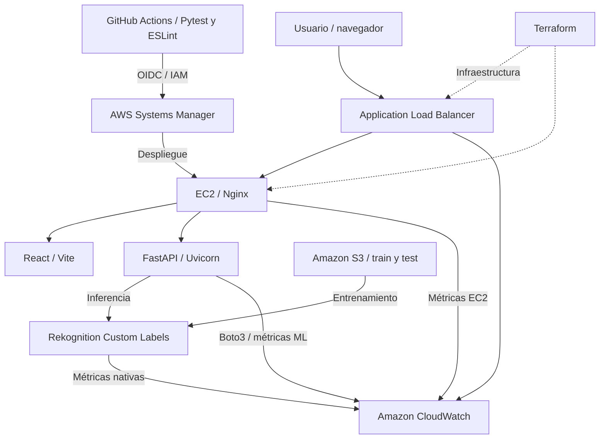

# Animal Vision — Clasificación de animales con IA en AWS

Proyecto final de Integración de Servicios de Aprendizaje Automático (ITESO, Otoño 2026).

**Autor:** Juan Pablo Pérez López · Ingeniería en Sistemas Computacionales

Animal Vision es una aplicación web que identifica animales en fotografías mediante aprendizaje supervisado. Integra preparación de datos, entrenamiento y evaluación de modelos, una API de inferencia, infraestructura como código, pruebas automatizadas, CI/CD y monitoreo continuo (MLOps).

- **Aplicación desplegada:** http://animal-vision-alb-395092843.us-east-1.elb.amazonaws.com (requiere recursos AWS activos).
- **Repositorio:** https://github.com/jpperezl2003/Proyecto_AWS_AmazonRekognition

## 1. Problema y objetivo

La identificación visual de animales puede verse afectada por diferencias de iluminación, fondo, postura y calidad de imagen. En lugar de definir reglas manuales para cada categoría, se utiliza un modelo entrenado con imágenes etiquetadas. El objetivo es desarrollar un clasificador de diez categorías y demostrar un flujo reproducible de integración, entrega y monitoreo continuos en AWS.

## 2. Arquitectura y tecnologías



| Tecnología | Responsabilidad |
|---|---|
| Amazon S3 | Almacenamiento de datasets |
| Amazon Rekognition Custom Labels | Entrenamiento e inferencia |
| Amazon EC2, Nginx y Uvicorn | Hospedaje del backend y frontend |
| Application Load Balancer | Acceso HTTP y health checks |
| AWS IAM y Systems Manager | Permisos y ejecución remota del despliegue |
| Amazon CloudWatch | Métricas, dashboard y alarmas |
| Python, FastAPI, Boto3 y Pillow | API, integración AWS y validación de imágenes |
| React y Vite | Interfaz web Wildlife Explorer |
| Terraform | Infraestructura como código |
| GitHub Actions, Pytest y ESLint | Automatización, pruebas y análisis de código |

## 3. Dataset y entrenamiento

Se utilizó [Rapidata/Animals-10](https://huggingface.co/datasets/Rapidata/Animals-10), con 23,554 registros en el conjunto de origen según el avance del proyecto. Se seleccionaron 2,000 imágenes distribuidas de forma equilibrada: 1,600 de entrenamiento y 400 de prueba.

Categorías: `butterfly`, `cat`, `chicken`, `cow`, `dog`, `elephant`, `horse`, `sheep`, `spider` y `squirrel`.

Las imágenes se organizaron en carpetas `train/<clase>/` y `test/<clase>/` y se importaron desde S3 a Rekognition Custom Labels. El modelo reducido utiliza 40 imágenes de entrenamiento por clase y el completo 160. El diseño utiliza 40 imágenes de prueba por clase como referencia común. No se dispone de una auditoría independiente de duplicados entre particiones.

### Comparación de modelos

| Métrica | Animal-classifier_small | Animal-classifier |
|---|---:|---:|
| Imágenes de entrenamiento | 400 | 1,600 |
| Imágenes de prueba | 400 | 400 |
| Precision macro | 94.57 % | 98.76 % |
| Recall macro | 96.75 % | 97.50 % |
| F1 macro | 95.58 % | 98.10 % |
| Uso | Comparación | Producción |

| Clase | F1 pequeño | F1 grande |
|---|---:|---:|
| butterfly | 0.964 | 0.974 |
| cat | 0.976 | 0.987 |
| chicken | 0.974 | 0.987 |
| cow | 0.937 | 0.974 |
| dog | 0.962 | 1.000 |
| elephant | 0.975 | 1.000 |
| horse | 0.949 | 0.950 |
| sheep | 0.905 | 0.962 |
| spider | 0.964 | 0.988 |
| squirrel | 0.952 | 0.988 |

Se seleccionó el modelo completo por su incremento de 2.52 puntos porcentuales en F1 macro y su mejora de F1 en las diez clases. Los promedios macro provienen de los valores por etiqueta redondeados por AWS. Los umbrales de evaluación varían por modelo y clase; los resultados no garantizan el mismo rendimiento en producción.

## 4. Estructura del repositorio

Estructura de los componentes principales documentados (no inventario exhaustivo):

```text
Proyecto_AWS_AmazonRekognition/
├── src/
│   ├── download_dataset.py
│   ├── main.py
│   ├── predict.py
│   └── monitoring.py
├── tests/
│   └── test_feedback.py
├── frontend/
├── web/
│   ├── src/
│   │   ├── App.jsx
│   │   └── styles.css
│   ├── vite.config.js
│   ├── package.json
│   └── package-lock.json
├── terraform/
│   ├── main.tf
│   └── bootstrap.sh.tftpl
├── scripts/
│   └── deploy.sh
├── .github/workflows/
│   └── CI.yml
├── requirements.txt
├── .gitignore
└── README.md
```

## 5. Instalación y ejecución local

### Requisitos previos

- Python 3, Git, Node.js (22 en el servidor), npm y AWS CLI.
- Cuenta AWS con permisos para Rekognition y una versión entrenada e iniciada en `us-east-1`.
- Terraform si se desea aprovisionar infraestructura.

### Backend (PowerShell)

```powershell
git clone https://github.com/jpperezl2003/Proyecto_AWS_AmazonRekognition.git
cd Proyecto_AWS_AmazonRekognition
python -m venv .venv
.\.venv\Scripts\Activate.ps1
python -m pip install -r requirements.txt
```

Configura acceso autorizado a AWS mediante un perfil o credenciales de desarrollo fuera del repositorio. Comprueba la identidad con `aws sts get-caller-identity`. Sustituye el ARN de ejemplo por el de tu versión activa de Rekognition:

```powershell
$env:AWS_DEFAULT_REGION = "us-east-1"
$env:MODEL_VERSION_ARN = "<ARN de la versión activa>"
$env:ENABLE_CLOUDWATCH_METRICS = "false"
python -m uvicorn src.main:app --reload --host 0.0.0.0 --port 8000
```

Swagger: http://localhost:8000/docs. Health check: http://localhost:8000/health.

### Frontend (otra terminal, desde la raíz)

```powershell
cd web
npm ci
npm run dev
```

Abre http://localhost:5173. Vite reenvía `/health`, `/predict` y `/feedback` al backend local. Para probar feedback real, activa `ENABLE_CLOUDWATCH_METRICS=true` en la terminal del backend antes de iniciarlo y utiliza permisos de CloudWatch; con métricas desactivadas el endpoint de feedback devuelve 503 por diseño.

## 6. API REST

| Método | Ruta | Descripción |
|---|---|---|
| GET | `/health` | Estado del proceso API |
| POST | `/predict` | Recibe una imagen en el campo `file` de multipart/form-data |
| POST | `/feedback` | Recibe evaluación humana en JSON |

La API valida imágenes JPEG/PNG no vacías, de tamaño estrictamente menor a 4 MB, y verifica su contenido mediante Pillow. Los errores de entrada devuelven HTTP 400; los de configuración o credenciales, 503; y los errores de AWS capturados, 502. La respuesta de inferencia contiene `filename` y `prediction`.

Ejemplos en PowerShell (ajusta la ruta de la imagen):

```powershell
curl.exe http://localhost:8000/health
curl.exe -F "file=@foto.jpg" http://localhost:8000/predict
```

Ejemplo de feedback para una predicción correcta (requiere métricas habilitadas):

```powershell
$body = @{correct=$true; predicted_animal='dog'; actual_animal='dog'} | ConvertTo-Json
Invoke-RestMethod -Uri 'http://localhost:8000/feedback' -Method Post -ContentType 'application/json' -Body $body
```

Para una predicción incorrecta se utiliza `correct=false` y una etiqueta real distinta, incluyendo `other` o `not_animal` si corresponde. El feedback no reentrena el modelo.

## 7. Pruebas automatizadas

Desde la raíz, con el entorno virtual activo:

```powershell
$env:ENABLE_CLOUDWATCH_METRICS = "false"
python -m pytest -v
cd web
npm ci
npm run lint
npm run build
```

Las pruebas documentadas del endpoint de feedback verifican evaluaciones correctas e incorrectas, inconsistencias, fallas de publicación y categorías inválidas. Se usan mocks para evitar publicar métricas reales durante estas pruebas. El backend también implementa validación de MIME, tamaño y formato real de las imágenes.

## 8. Infraestructura y CI/CD

Terraform aprovisiona EC2, ALB, target group, security groups y permisos IAM sobre la red configurada para el proyecto. Antes de crear recursos en otra cuenta, revisar las referencias de red, el rol OIDC, la región y los parámetros específicos de la infraestructura.

```powershell
cd terraform
terraform init
terraform validate
terraform plan
# Revisar el plan antes de ejecutar terraform apply.
```

El workflow de GitHub Actions ejecuta dos jobs de calidad (backend con Pytest y frontend con ESLint/build). Si ambos son exitosos y el cambio se publica en `main`, el job de despliegue asume un rol IAM mediante OIDC, utiliza AWS SSM y ejecuta `scripts/deploy.sh` en EC2. El script actualiza dependencias, compila React, publica los archivos estáticos, reinicia FastAPI y comprueba `/health`.

En producción, Nginx sirve los archivos estáticos y reenvía las rutas de API. El servidor utiliza `/opt/animal-vision` para el repositorio y `/var/www/animal-vision` para el frontend compilado. No guardar credenciales ni archivos de estado Terraform en Git. La configuración del workflow debe apuntar a la instancia activa; revisar sus variables y permisos antes de replicar el despliegue.

**Importante:** un cambio en el bootstrap puede reemplazar la instancia debido a `user_data_replace_on_change`. No ejecutar un `terraform apply` general sobre el entorno de demostración sin revisar el plan. Las alarmas se configuraron manualmente en CloudWatch.

## 9. Monitoreo continuo y retroalimentación

Dashboard: `Animal-vision-monitoring`, región `us-east-1`. Las métricas nativas incluyen CPU, tráfico de red, estado de EC2, solicitudes y tiempo de respuesta del ALB y solicitudes/errores de Rekognition.

El módulo `monitoring.py` publica las siguientes métricas en `AnimalVision/ML`:

| Métrica | Significado |
|---|---|
| PredictionCount | Conteo por dimensión Animal, incluyendo Unidentified |
| PredictionConfidence | Confianza porcentual de predicciones identificadas |
| PredictionErrors | Errores técnicos de inferencia capturados |
| CorrectPredictions | Evaluaciones humanas correctas |
| IncorrectPredictions | Evaluaciones humanas incorrectas |
| UserFeedbackCount | Total de evaluaciones publicadas |

El porcentaje de aciertos reportados se calcula como `100 * SUM(CorrectPredictions) / SUM(UserFeedbackCount)` para el intervalo seleccionado, siempre que existan evaluaciones. No equivale al F1 ni a la exactitud del conjunto de prueba. Las métricas locales y de producción pueden compartir namespace.

Alarmas configuradas o documentadas con estos umbrales objetivo:

| Alarma | Condición |
|---|---|
| CPU_Usage | CPU media ≥ 80 % |
| AnimalVision-Unavailable | HealthyHostCount mínimo < 1 |
| AnimalVision-PredictionErrors | Suma de errores ≥ 1 |
| AnimalVision-LowConfidence | Confianza media < 70 % |

No se utiliza SNS; los estados se consultan en CloudWatch. Revisar el estado efectivo de las alarmas antes de la demostración.

## 10. Limitaciones, ética y trabajo futuro

Animal Vision tiene fines educativos; no identifica todas las especies ni sustituye una evaluación científica o veterinaria. El balance entre clases no garantiza representatividad de razas, ambientes o condiciones de iluminación. Las imágenes fuera del dominio pueden recibir una etiqueta incorrecta.

Estudiantes, docentes y personas interesadas en animales pueden beneficiarse de la herramienta. Usuarios con acceso limitado a Internet o personas fotografiadas incidentalmente pueden verse afectados por barreras de acceso o riesgos de privacidad. Se recomienda evitar fotografías con información personal, verificar derechos de uso de las imágenes y no interpretar la confianza como certeza.

La retroalimentación no está autenticada ni deduplicada y no modifica el modelo. El prototipo utiliza HTTP y una sola instancia. Como trabajo futuro se propone HTTPS, separación de ambientes y métricas, pruebas de robustez, verificación de duplicados y reentrenamiento asistido con correcciones verificadas.

## 11. Demostración y cierre de recursos

Para la demostración: verificar que Rekognition esté en estado `RUNNING`, EC2 activa y el target group saludable; abrir la aplicación, cargar una imagen, consultar la predicción, registrar feedback y mostrar CloudWatch y GitHub Actions.

AWS puede generar cargos por el modelo activo, EC2, ALB, almacenamiento y monitoreo. Después de la demostración, detener la versión de Rekognition y revisar los recursos facturables. Solo destruir infraestructura mediante Terraform si se ha confirmado que ya no es necesaria y se comprende el plan de destrucción.

## Referencias

- [Dataset Animals-10](https://huggingface.co/datasets/Rapidata/Animals-10)
- [Amazon Rekognition Custom Labels](https://docs.aws.amazon.com/rekognition/latest/customlabels-dg/)
- [Amazon CloudWatch](https://docs.aws.amazon.com/AmazonCloudWatch/latest/monitoring/)
- [FastAPI](https://fastapi.tiangolo.com/)
- [GitHub Actions](https://docs.github.com/en/actions)
- [Terraform](https://developer.hashicorp.com/terraform/docs)
